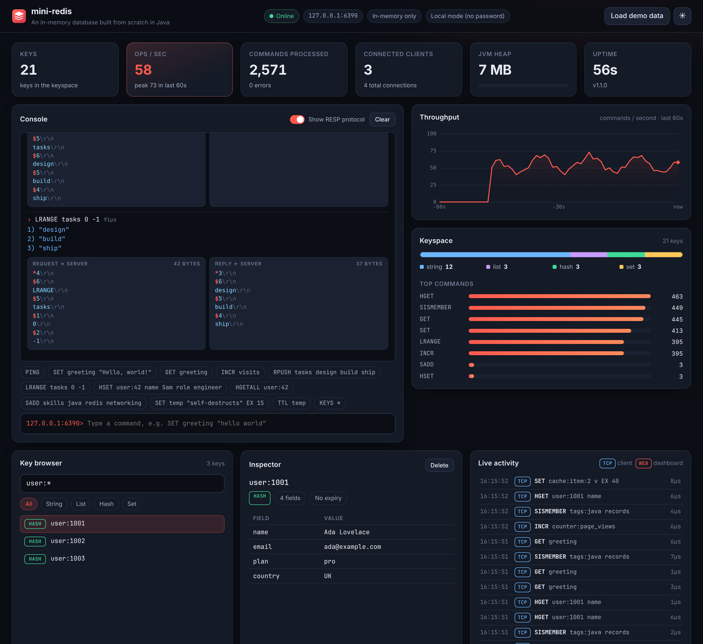

# mini-redis

[](https://github.com/tejaswinibhosalee/Build-Your-Own-Redis/actions/workflows/ci.yml)


[](LICENSE)

**A Redis-compatible in-memory database written from scratch in Java 21, with a live React dashboard.**

mini-redis implements the real **RESP wire protocol**, so the official `redis-cli` and any Redis client library
(Jedis, Lettuce, redis-py, ...) can talk to it. It supports strings, lists, hashes and sets, key expiry (TTL),
append-only-file persistence, and password authentication, and ships with a web dashboard showing what the
server is doing in real time.



## Highlights

- **Wire-compatible with Redis**: a hand-written RESP parser and encoder; works with the real `redis-cli`.
- **Concurrent TCP server on Java 21 virtual threads**: one cheap thread per connection, with commands
  serialized behind a single lock so operations like `INCR` stay atomic, like Redis's single-threaded model.
- **TTL expiry, both lazy and active**: keys are checked on access *and* swept in the background.
- **Durability**: an append-only file (AOF) replayed on startup, with compaction via `SAVE`.
- **Live dashboard (React + Vite)**: throughput chart, keyspace breakdown, key browser and inspector,
  a live activity feed, and a console that shows the **raw RESP bytes** for every command.
- **Secure by default**: loopback-only binding, protected mode, optional password auth, DoS limits, and a
  dashboard hardened against XSS, CSRF, DNS rebinding and clickjacking (see [SECURITY.md](SECURITY.md)).
- **Well tested**: 70+ unit and integration tests, including attack scenarios, run on every push by CI.

## Quick start

You need **Java 21+** and **Maven**. Node.js is *not* required: Maven downloads a private copy to build the
dashboard.

```bash
mvn package
java -jar target/mini-redis.jar
```

Then:

- open the dashboard at **http://localhost:8080**
- click **Load demo data**, or connect with the real Redis CLI:

```bash
redis-cli -p 6379
127.0.0.1:6379> SET greeting "hello"
OK
127.0.0.1:6379> GET greeting
"hello"
127.0.0.1:6379> RPUSH tasks design build ship
(integer) 3
127.0.0.1:6379> LRANGE tasks 0 -1
1) "design"
2) "build"
3) "ship"
```

No `redis-cli`? `nc localhost 6379` works too: type `PING` and press Enter. The server also understands plain
inline commands.

### With a password

Set the password through an **environment variable** or a **file**, never as a command-line flag (command
lines are visible to every user on the machine via `ps`):

```bash
export MINI_REDIS_PASSWORD="$(openssl rand -base64 24)"
java -jar target/mini-redis.jar
redis-cli -p 6379 -a "$MINI_REDIS_PASSWORD" PING
```

The dashboard will then show a login screen.

### With Docker

```bash
cp .env.example .env      # then put your own password in .env
docker compose up --build
```

The compose file publishes both ports on `127.0.0.1` only, runs the container as a non-root user with all
Linux capabilities dropped, and stores data in a named volume.

## Configuration

| Option | Default | Description |
|--------|---------|-------------|
| `--port <n>` | `6379` | TCP port for Redis clients |
| `--bind <address>` | `127.0.0.1` | Address to listen on (`0.0.0.0` = all interfaces) |
| `--max-clients <n>` | `10000` | Maximum simultaneous client connections |
| `--aof-file <path>` | `mini-redis.aof` | Append-only persistence file |
| `--no-aof` | | Keep data in memory only |
| `--dashboard-port <n>` | `8080` | Web dashboard port |
| `--dashboard-bind <address>` | `127.0.0.1` | Dashboard listen address |
| `--no-dashboard` | | Don't start the dashboard |
| `--password-file <path>` | | Read the password from a file |
| `MINI_REDIS_PASSWORD` (env var) | | Password for clients and the dashboard |

Run `java -jar target/mini-redis.jar --help` for the full list.

## Supported commands

| Category   | Commands |
|------------|----------|
| Connection | `PING`, `ECHO`, `AUTH`, `QUIT` |
| Generic    | `DEL`, `EXISTS`, `EXPIRE`, `TTL`, `PERSIST`, `KEYS`, `TYPE`, `FLUSHALL` |
| Strings    | `SET` (`EX`/`PX`/`NX`/`XX`), `GET`, `INCR`, `DECR`, `APPEND`, `STRLEN` |
| Lists      | `LPUSH`, `RPUSH`, `LPOP`, `RPOP`, `LLEN`, `LRANGE` |
| Hashes     | `HSET`, `HGET`, `HGETALL`, `HDEL` |
| Sets       | `SADD`, `SMEMBERS`, `SREM`, `SISMEMBER` |
| Server     | `DBSIZE`, `SAVE`, `INFO`, `COMMAND`/`CONFIG` (stubs, for client compatibility) |

## How it works

```
 redis-cli / client libs ──TCP──▶ MiniRedisServer ──▶ ClientHandler (1 virtual thread per connection)
                                                          │  RespReader: bytes → ["SET","k","v"]
                                                          ▼
 Browser (React) ──HTTP/JSON──▶ DashboardServer ──▶ CommandExecutor ── one global lock ──▶ Database
                                     │                    │                                (String/List/Hash/Set + TTLs)
                                     │                    ├──▶ AofWriter (append every write to disk)
                                     └── reads ◀── ServerStats (observer: ops/sec, activity feed)
```

Every command, whether from `redis-cli` or the dashboard console, goes through the same `CommandExecutor`,
so the dashboard shows exactly what real clients experience. See [docs/ARCHITECTURE.md](docs/ARCHITECTURE.md)
for the request lifecycle, the concurrency model and the persistence design.

## Project layout

```
├── src/main/java/dev/tejaswini/miniredis/
│   ├── MiniRedisApplication.java   entry point: options + wiring
│   ├── protocol/                   RESP parsing (RespReader) and encoding (RespWriter)
│   ├── core/                       Database (the keyspace), expiry, glob matching
│   ├── command/                    CommandExecutor (dispatch + locking) and command groups in impl/
│   ├── persistence/                AofWriter (append + rewrite), AofLoader (replay)
│   ├── server/                     TCP accept loop, per-connection handler, AUTH, protected mode
│   ├── security/                   password checking and login throttling
│   ├── stats/                      live metrics (ops/sec, per-command counts, activity feed)
│   └── dashboard/                  HTTP server + JSON API for the web UI
├── src/test/java/...               unit + integration tests
├── frontend/                       React + Vite dashboard (built into the jar by Maven)
│   └── src/components/             Console, KeyBrowser, Inspector, ThroughputChart, ...
├── Dockerfile, docker-compose.yml
└── docs/ARCHITECTURE.md
```

## Development

```bash
mvn test                           # run all tests
java -jar target/mini-redis.jar    # backend + built dashboard on :8080

# Hot-reloading UI while you edit React code (needs Node 20+):
cd frontend && npm ci && npm run dev    # http://localhost:5173, API proxied to :8080
```

## Deliberately out of scope

To keep the codebase small enough to read in one sitting, mini-redis does **not** implement pub/sub,
transactions (`MULTI`/`EXEC`), Lua scripting, sorted sets, streams, replication, clustering, ACL users, RESP3
or RDB snapshots. It also has no TLS. These are natural next steps.

## License

[MIT](LICENSE)
